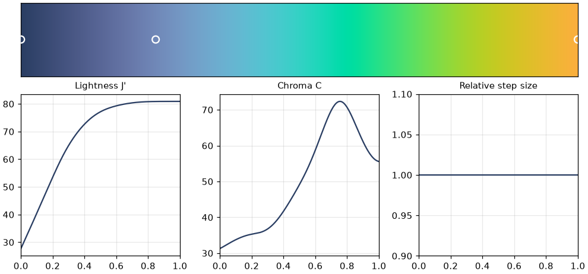
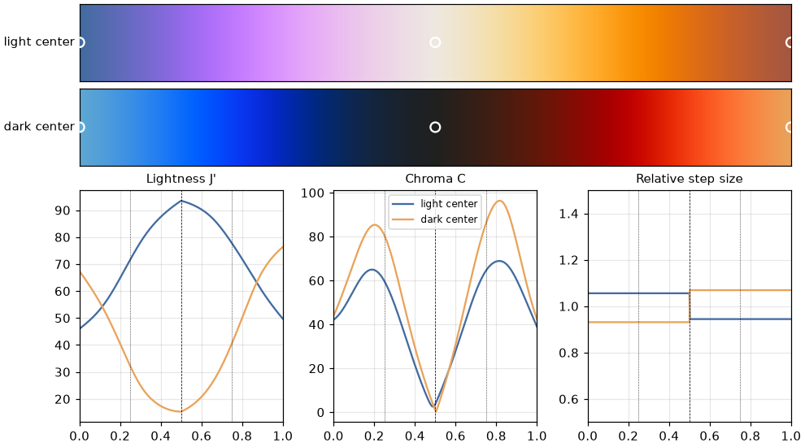
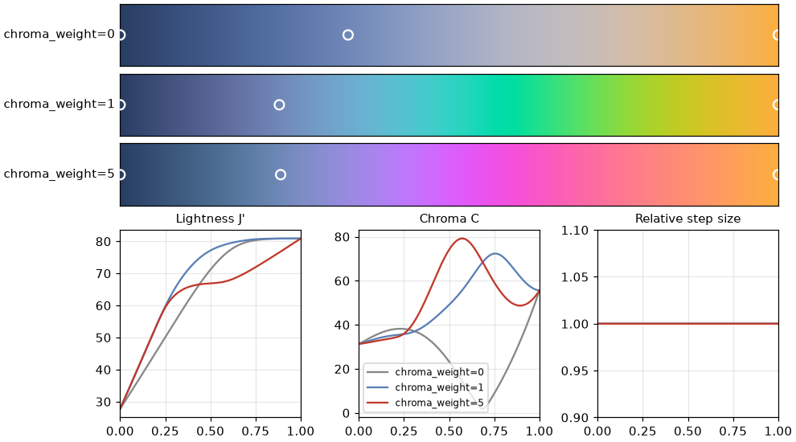
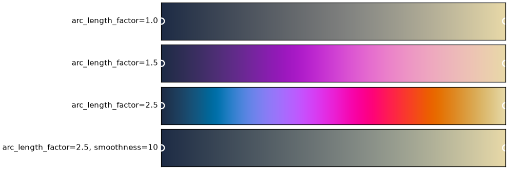
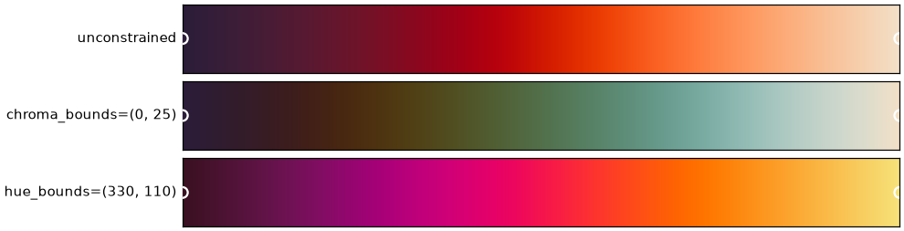
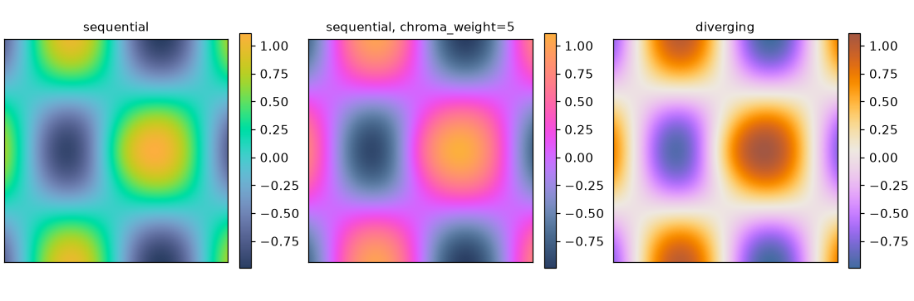

=============================
Creating Continuous Colormaps
=============================

Glasbey can also fit continuous colormaps through colours you need to use. The curve is fitted in CAM02-UCS,
where Euclidean distance approximates perceptual difference, and sampled by perceptual arc length so that equal
steps in data correspond to approximately equal perceived colour change.

.. code:: python3

    import glasbey

    cmap = glasbey.create_colormap(["#2a3e63", "#7088b8", "#fcaf3e"])
    cmap.to_matplotlib(name="brand")

The circles mark the seed colours. Below the colormap are its lightness and chroma along the map, and the
perceptual distance between consecutive samples relative to the mean. The flat step-size line is the perceptual
uniformity. Lightness always increases, but not necessarily linearly: the curve may spend part of its length on
changes of hue and chroma instead.

Seed colours are unordered. In a sequential map they are ordered by perceptual lightness (``direction`` selects
increasing or decreasing lightness), and every distinct seed lies exactly on the fitted curve. Its location is
given by ``cmap.seed_positions``, in the same order as the input.

Diverging colormaps
-------------------

.. code:: python3

    cmap = glasbey.create_colormap(
        ["#426ba0", "#eee8e0", "#a35742"], mode="diverging"
    )

The center is always one of the supplied seeds: the lightest seed by default, or the darkest with
``center_lightness="dark"``. ``center_color`` can select a particular seed with that extreme lightness. The center is
at position 0.5, and the remaining seeds are divided between two arms. Each arm is perceptually uniform, so if the
arms have different perceptual lengths they change colour at different rates.

The dashed line marks the center and the dotted lines mark the middle of each arm, where the chroma reward peaks.
The step-size plot shows each arm is uniform, with a small jump at the center where the two arms' rates differ.

Shaping the curve
-----------------

Four parameters control the shape of the curve:

* ``max_control_points`` limits the number of cubic spline coefficients per arm, and hence how complex the curve
  can be.
* ``arc_length_factor`` sets the maximum length of the curve relative to a direct feasible reference curve. Larger
  values let the colormap travel further through colour space.
* ``smoothness`` penalises bending; larger values give straighter, gentler curves.
* ``chroma_weight`` rewards vivid colours near the middle of each arm (0.5 for sequential maps, 0.25 and 0.75 for
  diverging maps). Set it to zero to disable the reward.

The chroma reward is what keeps colormaps vibrant. Without it the curve takes the most direct route between the
seeds, which here passes through nearly grey colours; increasing the weight bends the curve through more vivid ones.

The arc length factor and smoothness trade off how far the curve may travel through colour space against how
much it may bend. With two seeds and ``arc_length_factor=1.0`` the curve is the direct route; allowing more
length lets it sweep through more hues, and a large ``smoothness`` pulls it back toward a straight path.

.. code:: python3

    glasbey.create_colormap(["#1d2b45", "#e8d9a8"], arc_length_factor=2.5)
    glasbey.create_colormap(["#1d2b45", "#e8d9a8"], arc_length_factor=2.5, smoothness=10)

Constraints
-----------

The same ``lightness_bounds``, ``chroma_bounds``, ``hue_bounds`` and RGB channel bounds used for palettes may be
supplied. Unlike palette creation, the lightness and chroma bounds are unrestricted by default. Bounds are strict:
every seed must satisfy them, and they are never relaxed to make a fit succeed. A colour grid (``grid_size``,
``grid_space``) guides the curve around the edges of the feasible region, but the output is not snapped to the grid.

.. code:: python3

    glasbey.create_colormap(["#2b1d3a", "#f3e0c8"], chroma_bounds=(0, 25))
    glasbey.create_colormap(["#3a1020", "#f6e27a"], hue_bounds=(330, 110))

Hue bounds may wrap around zero, as in the last example, which keeps to reds, oranges and yellows.

Every evaluated colour is checked against the bounds. This numerical check is not a mathematical proof that every
point on the curve is in gamut. If no feasible curve is found, a ``ValueError`` is raised; a finer grid, more control
points or more iterations may help. If the optimizer reaches its iteration limit, the best validated feasible curve
is returned with a ``RuntimeWarning``.

Sampling
--------

``cmap(positions)`` returns float sRGB colours. ``cmap.sample(n_colors)`` returns uniformly spaced positions and
colours; ``include_seeds=True`` adds the exact seed positions, so the table includes every seed but is no longer
uniformly spaced. ``as_hex=True`` returns hex codes, provided rounding to 8-bit colour does not violate the bounds.
``cmap.diagnostics`` reports per-arm length, spacing uniformity, curvature, chroma and optimizer status.

``cmap.to_matplotlib()`` gives a matplotlib ``ListedColormap`` for use with any plotting function:

.. code:: python3

    import matplotlib.pyplot as plt

    plt.imshow(data, cmap=cmap.to_matplotlib())

